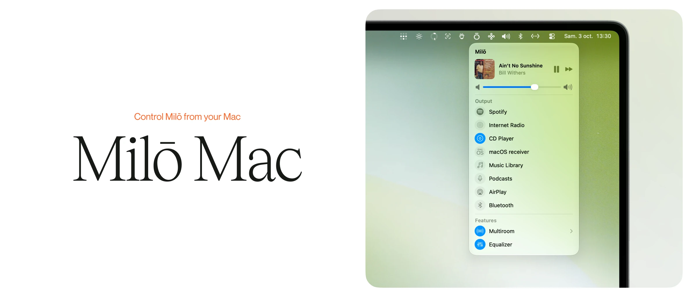

  

# Milō Mac

Control Milō from your Mac's menu bar.

Milō Mac is the macOS companion for [Milō](https://github.com/leodurandfr/Milo), the
Raspberry Pi music system. It finds your Milō on the network and puts its sources, the track
playing, its volume and its rooms in a native panel in the menu bar, with no browser and no
window to keep open. It can also send your Mac's own sound to Milō.

## Requirements

- macOS 26 (Tahoe) or later.
- A Milō on the same network as your Mac.

## Install

Download the latest `.dmg` from [Releases](https://github.com/leodurandfr/Milo-Mac/releases),
open it and drag **Milō** into **Applications**. The app is signed and notarized by Apple, so
it opens without a warning.

Milō Mac finds your Milō by itself over Bonjour: there is nothing to set up.

## The panel

Click the Milō icon in the menu bar:

- **Now playing**: the track, its cover, and the buttons the current source accepts.
- **Volume**, with a slider.
- **Sources**: the ones enabled on your Milō, in the same order. Click one to switch to it.
  With Internet Radio as the current source, the arrow beside it opens your favorite stations;
  with Music Library, its arrow opens a search of your artists, albums and tracks.
- **Multiroom** and **Equalizer**, each turned on or off in one click. With multiroom on, the
  arrow beside it shows every room with its own volume.

**Option-click** the icon for Settings and Quit.

The interface is available in English, French, German, Spanish, Italian, Portuguese, Hindi and
Simplified Chinese.

## Volume from the keyboard

**Right Option + ↑ / ↓** changes Milō's volume from any app, with an on-screen indicator like
the Mac's own. macOS asks for the Accessibility permission the first time.

Settings holds the volume step, launch at login, and whether the indicator also shows for
changes made elsewhere, on Milō's screen or from a phone.

## Your Mac's sound on Milō

The **macOS receiver** source plays your Mac's sound through Milō, with low latency. It needs
[roc-vad](https://github.com/roc-streaming/roc-vad), a virtual audio driver that Settings
installs for you. Restart the Mac once afterward, then choose **Milō** as the sound output.
The link itself is tuned on Milō, in the macOS receiver settings, and Milō Mac applies it.

This is optional. Without the driver everything else works, and the source shows
*Driver required*.

## Building from source

Open `Milo Mac.xcodeproj` in Xcode 26 or later and build the `Milo Mac` scheme. The deployment
target is macOS 26.0, and the project builds without warnings in the Swift 6 language mode.

## Uninstalling

Run [`uninstall.sh`](uninstall.sh) to remove the app, its preferences and, if you installed
it, the roc-vad driver, then restart the Mac. If Milō still shows in System Settings > General >
Login Items, remove it there: that entry is held by macOS, and only the app could withdraw it.

## License

[MIT](LICENSE). Contributions are welcome: see [CONTRIBUTING.md](CONTRIBUTING.md).
